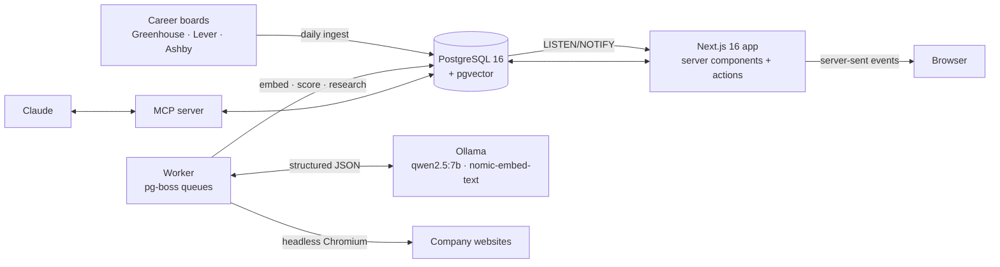

# Shortlist: portfolio and resume kit

Everything needed to put this project on a resume, a portfolio site, LinkedIn or in an interview, in one file. Every number below is measured in this repo; the **Source** column of the [numbers sheet](#9-numbers-sheet) says where, so each one can be re-checked.

> **Before using this file**
> - Fill in the placeholders: `<DEMO_URL>` (the Vercel demo, once deployed) and `<YOUR NAME>`.
> - The match-scoring eval labels are drafts written with an AI assistant ([evals/match/README.md](../evals/match/README.md) says so). Review the 48 labels in `evals/match/pairs.json`, re-run `npm run eval:match`, and only then quote the AUC/F1 figures. They are marked † below.
> - The project was built with heavy use of an AI coding assistant (Claude Code). Say so if asked, and be ready to explain every design decision in section 6: interviewers will ask why, not just what.

---

## 1. Quick facts

| | |
|---|---|
| **Name** | Shortlist: Self-Hosted AI Job Search Agent |
| **One line** | A self-hosted job search app that pulls ~8,300 live jobs from 45 companies' career boards, ranks them with hybrid search, scores fit with a local LLM whose mistakes are corrected in code, researches companies with a headless browser, and tracks applications. No paid APIs. |
| **Repo** | https://github.com/akashkuushwahaa/Self-Hosted-AI-Job-Search-Agent |
| **Live demo** | `<DEMO_URL>` (runs entirely on a PGlite snapshot; no server, model or key needed) |
| **Role** | Solo: design, backend, frontend, ML evaluation, infra |
| **When** | November 2026 |
| **Size** | ~6,000 lines of TypeScript; 20+ commits; 10 database migrations; 141 tests (28 files) |
| **Cost to run** | $0: local models (Ollama), Postgres, free Vercel plan for the demo |

**Stack:** TypeScript, Next.js 16 (App Router, Cache Components, server actions), React 19, Tailwind CSS 4, PostgreSQL 16 + pgvector, Drizzle ORM, PGlite (Postgres in WASM), Ollama (`qwen2.5:7b`, `nomic-embed-text`), pg-boss (job queue on Postgres), Playwright, Better Auth, Zod, Model Context Protocol (MCP) SDK, Vitest, Docker Compose, GitHub Actions.

---

## 2. Taglines

- **Short (≤ 100 chars):** Self-hosted AI job search: hybrid search, local-LLM fit scores checked by code, $0 to run.
- **Medium:** An AI job search agent that runs on your own machine: it ingests 8k+ live postings daily, ranks them by hybrid keyword + vector search, and scores fit with a local 7B model whose seniority and location judgments are enforced in code, lifting ranking AUC from 0.71 to 0.91†.
- **Why it exists:** I replaced my earlier job-search project because it depended on free tiers and API credits that expired. This one has no dependency that can stop working: public career boards, local models, Postgres.

---

## 3. Resume entries

Pick the version that fits the role. Keep 3–4 bullets.

### AI / ML engineer version

**Shortlist: Self-Hosted AI Job Search Agent** · TypeScript, Next.js, PostgreSQL/pgvector, Ollama, Playwright · [GitHub](https://github.com/akashkuushwahaa/Self-Hosted-AI-Job-Search-Agent) · [Demo](<DEMO_URL>)
- Built a job-matching pipeline over ~8,300 live postings from 45 companies: hybrid search (Postgres full-text + pgvector embeddings fused with reciprocal rank fusion) and a local 7B LLM that scores candidate fit through structured JSON output.
- Raised ranking AUC from 0.71 (embedding similarity) to 0.91† on a 48-pair labeled eval by letting the model extract facts (required years, the posting's location rule) and deciding seniority and location in code; caught 9/9 stated location rules with no false positives, up from 5/9.
- Cut hallucinated output: company briefs keep a product or technology only if the crawled pages contain it (the model listed 8 technologies for one company, none of which appeared on its pages); a measured cosine-distance cutoff stops nonsense queries returning 100 "matches".
- Ran 7 eval iterations, keeping a results file per version and shipping only changes that improved the numbers.

### Full-stack engineer version

**Shortlist: Self-Hosted AI Job Search Agent** · Next.js 16, React 19, PostgreSQL, Drizzle, Tailwind · [GitHub](https://github.com/akashkuushwahaa/Self-Hosted-AI-Job-Search-Agent) · [Demo](<DEMO_URL>)
- Built a full-stack job search app (search with filters, AI match scores, company research, drag-and-drop application tracker with optimistic updates, auth with sign-up controls, password reset and account deletion) on Next.js 16 server components and server actions.
- Streamed background-job progress to the browser with Postgres LISTEN/NOTIFY and server-sent events: no polling and no extra message broker.
- Shipped a zero-cost public demo: the whole app runs on a Postgres-in-WASM (PGlite) snapshot with recorded model output on Vercel's free plan, with per-visitor tracker state kept in a cookie so visitors never see each other's changes.
- Covered the app with 141 tests, including integration tests against real Postgres + pgvector in-process (no Docker), and a CI smoke test that loads every public page in headless Chromium.

### Backend / infrastructure version

**Shortlist: Self-Hosted AI Job Search Agent** · Node.js, PostgreSQL/pgvector, pg-boss, Docker, GitHub Actions · [GitHub](https://github.com/akashkuushwahaa/Self-Hosted-AI-Job-Search-Agent)
- Built a scheduled ingest → embed → score agent on pg-boss (a Postgres-backed queue): daily cron with catch-up after the host sleeps, per-user exclusive queues, and heartbeats that recover a crashed worker's job in ~80 s instead of blocking for up to 3 h.
- Ingested ~8,300 jobs from 6 public board APIs (Greenhouse, Lever, Ashby, SmartRecruiters, Workable, Recruitee) with Zod-validated parsers; jobs a board drops are closed rather than deleted, a failed fetch never closes anything, and embeddings are recomputed only when the embedded text changes.
- Packaged the app, worker (with Chromium), migrations and Postgres as one `docker compose up`; a fresh install fetches and embeds all jobs with no manual step (8.5 min for 7,224 jobs).
- Cut a per-page-load model call from ~85 ms to ~1–2 ms by caching the profile embedding under a hash of the model and input text, so it invalidates itself on any change.

### One-line version (for a crowded resume)

**Shortlist** – self-hosted AI job search (Next.js, Postgres/pgvector, local LLM): hybrid search over 8k live jobs, LLM fit scores with code-enforced checks (AUC 0.71 → 0.91†), background agent on a Postgres queue, $0 to run.

---

## 4. Portfolio page copy

### The problem

Job boards rank by recency or paid placement, not by fit, and AI job tools usually depend on paid APIs or free tiers that run out. My earlier project broke exactly that way. I wanted a job search that ranks by real fit, explains its scores, and keeps working indefinitely at no cost.

### What it does

- **Live jobs, no API keys.** Pulls ~8,300 open roles daily from the public career boards (Greenhouse, Lever, Ashby, SmartRecruiters, Workable, Recruitee) of 45 companies, including Stripe, OpenAI, Anthropic, Perplexity, Databricks, Cloudflare, Razorpay, Paytm, Freshworks, Groww, CRED and Meesho. Adding a company is one line in a config file.
- **Search that understands intent.** "frontend internship in India" finds 0 jobs by keyword alone; hybrid search returns relevant Bengaluru and remote roles. Filters for level, country, remote, company and posting date.
- **Fit scores you can trust.** A local LLM scores each job against your profile and resume (0–100, with a reason and matched/missing skills). Code overrides the model where it is unreliable: seniority, location and work-authorization rules.
- **Company briefs.** A headless browser reads a company's own website and the model writes a brief with interview talking points, keeping only facts the pages contain.
- **Your judgment counts.** Hide jobs you're not interested in, and rate the model's scores; ratings export as labeled pairs to grow the eval.
- **Tailored applications.** A resume summary, resume points and a cover letter written for one job from your own resume; code removes any point whose quote isn't in the resume and any claimed skill you don't have, and lists what it removed.
- **Application tracker.** Kanban board (drag and drop or keyboard), notes, applied date, follow-ups with overdue reminders.
- **Works while you sleep.** A background agent refreshes jobs and scores new matches every day; the app shows "N new since your last visit".
- **Use it from Claude.** An MCP server exposes search, matches, tracker and company briefs as tools for Claude.

### Architecture

- **One database does everything:** relational data, full-text search (GIN index), vectors (pgvector), the job queue (pg-boss) and pub/sub (LISTEN/NOTIFY). No Redis, no Elasticsearch, no vector database.
- **Model work never runs in a request:** buttons queue jobs; the worker runs them and streams progress back.
- **Demo mode** swaps Postgres for PGlite (Postgres compiled to WASM) loaded from a committed snapshot, and replays recorded embeddings, so the same code and queries run on a free serverless host.

### Results

| | Before | After | How |
|---|---|---|---|
| Ranking AUC (good + partial matches)† | 0.71 (embeddings only) | **0.91** | LLM scoring + code-enforced gates |
| Stated location rules caught† | 5/9 | **9/9**, 0 false positives | model quotes the rule, code decides |
| Lenient precision at score ≥ 40† | 0.82 (v2) | **1.00** (recall 0.76) | same |
| Nonsense query results ("asdf qwerty") | 100 | **0** | measured cosine-distance cutoff |
| Profile embedding per page load | ~85 ms (Ollama call) | **~1–2 ms** | hash-keyed cache |
| Crashed worker's job blocked | up to 3 h | **~80 s** | queue heartbeats |
| Setup | 9 commands | **1** (`docker compose up`) | Dockerfile + compose |

† draft labels; see the note at the top.

### Engineering quality

- **141 tests:** unit tests for pure logic, and integration tests that boot real Postgres + pgvector in-process (PGlite) with every migration applied, then run the real search, ingest, scoring and server actions. No Docker needed to test.
- **Tests that can fail:** checked by deliberately breaking code (reverting the semantic cutoff or the re-embed rule makes tests fail).
- **CI on every push:** lint, typecheck, tests, migrations on an empty pgvector Postgres, production build, then a demo build served and smoke-tested in headless Chromium (fails on any console error).
- **Security:** every server action re-checks the signed-in user and validates input with Zod; one user can never read or change another's data (integration-tested); research only crawls a curated list of sites, never a user-supplied URL; sign-up can be closed or invite-only (enforced in the auth layer, covering OAuth too); password reset doesn't reveal which emails have accounts; account deletion cascades through every table.
- **Honest failure modes:** search falls back to keyword-only if the model is down and says so; a worker that isn't running is reported after 30 s instead of "Queued…" forever; a failed background run, and its cause, is still shown after a refresh.

---

## 5. Features in detail

| Area | Detail |
|---|---|
| Ingest | Zod-validated parsers for 6 board APIs (SmartRecruiters needs a detail request per posting); upsert by (source, board, external id); closed instead of deleted; failed fetch never closes jobs; re-embed only when title, description, company or location changes |
| Search | Postgres `websearch_to_tsquery` over a GIN index + pgvector cosine distance, merged by reciprocal rank fusion (k = 60); semantic hits kept only under `min(0.40, best + 0.08)` (measured on 18 queries); filters as SQL regex built from the same word lists as tested JS regexes |
| Fit ranking | Scored ≥ 40 first, then unscored by embedding closeness, then poor scores; joins search results as a third ranked list |
| Scoring | `qwen2.5:7b` via Ollama structured output: score, role fit, required years, quoted location rule, skills; code computes seniority, verifies the location rule against the posting's own sentences, strips non-skill tags, caps the score |
| Resume | PDF signature and size checks; only extracted text stored; on the worker, the model fills empty profile fields and code adds only skills the resume text contains (upload answers in 0.3 s instead of ~30 s) |
| Research | Playwright reads the home page + up to 3 same-site About/Engineering/Culture pages; brief keeps only names found on the pages; shared by all users, refreshed weekly |
| Background agent | pg-boss queues (exclusive per user), daily cron with `missed: once`, heartbeats, first run on an empty database, progress over LISTEN/NOTIFY → SSE |
| Tracker | 5 columns, drag and drop + keyboard menu, `useOptimistic`, undo after remove, notes, applied date (auto-filled), next step, follow-ups with overdue alerts in the viewer's time zone |
| Tailoring | Worker job; model drafts summary, ≤ 6 resume points with evidence quotes, cover letter; code keeps a point only if its quote is in the resume and names the point's skills, drops sentences claiming missing skills, lists removals (18 removed across 5 real postings) |
| Feedback | "Not interested" hides a job from every list and from scoring, with Undo; thumbs up/down on a score (kept as it was when rated); `npm run eval:feedback` exports rated pairs as eval labels |
| Accounts | Better Auth (email/password, optional GitHub); `ALLOW_SIGNUP` / `ALLOWED_EMAILS`; SMTP password reset; delete account |
| Demo | PGlite snapshot (1,272 jobs, 30 scored matches, briefs), recorded embeddings, per-visitor tracker in a cookie |
| MCP | 6 tools: `search_jobs` (with filters), `get_job`, `list_matches`, `list_tracker`, `track_job`, `company_brief` |
| Ops | Docker Compose (app, worker with Chromium, migrate, Postgres, optional Ollama), CI smoke test, OpenGraph image, per-page titles |

---

## 6. Key decisions (and why)

These are the "why did you…" answers.

1. **Let the model extract, let code decide.** The 7B model reliably extracts facts (required years, a quote of the location rule) but judges them badly: it called "must be authorized to work in the US" merely "relocate" for a candidate in India. So the model quotes, and code decides from the posting's own sentence. This took location rules caught from 5/9 to 9/9 with no false positives.
2. **Evaluate before shipping.** 48 labeled candidate–job pairs, AUC and precision/recall per version, one results file per run. A version that looked simpler (v3: score from skill coverage) lost on the eval and was dropped.
3. **Postgres for everything.** Full-text search, vectors, the job queue and pub/sub in one database means one thing to run, back up and reason about, which matters for a self-hosted app.
4. **Hybrid search, with a cutoff.** Keyword search misses intent; vector search always returns *something*. Rank fusion combines them; a distance cutoff measured on real and nonsense queries makes "no results" possible.
5. **A demo that can't expire.** Postgres compiled to WASM plus recorded model output means the public demo needs no server, database or API key.
6. **New tables, not new columns, for later features.** The demo snapshot is a committed binary; adding columns to existing tables would break it. Separate tables (`profile_embeddings`, `matches_seen`, `application_details`) keep it working without rebuilding the snapshot.
7. **Self-invalidating caches.** The profile embedding is cached under a hash of the model name and the exact text, so an edit, a prompt change or a model switch can never serve a stale vector, and no code path has to remember to clear it.

---

## 7. Interview stories (STAR)

**1. The model that couldn't judge location**
- *Situation:* the 7B model kept scoring jobs as good fits when the posting required US work authorization the candidate didn't have.
- *Task:* catch stated location rules without false positives.
- *Action:* changed the prompt to make the model quote the rule instead of judging it, then had code accept the quote only if the posting contains a rule sentence naming the same place. Iterated v4 → v6 on the eval: requiring an exact quote dropped real rules (4/9), because the model paraphrases.
- *Result:* 9/9 stated rules caught, 0 false positives, lenient AUC 0.91†.

**2. Search that always found 100 matches**
- *Situation:* any query, even "pastry chef", reported 100+ matches, because vector search always returns the nearest jobs.
- *Action:* measured distances on 18 real and nonsense queries and found nonsense starts above 0.40 while real hits sit below; set the cutoff at `min(0.40, best + 0.08)` and unit-tested it.
- *Result:* nonsense queries return 0, real queries keep their relevant results; the count shown became honest.

**3. One user's demo changing everyone's board**
- *Situation:* every demo visitor is the same fictional user on one shared in-memory database, so one visitor removing a card changed the board for everyone.
- *Action:* kept the snapshot read-only and stored each visitor's changes as a small validated overlay in their own cookie, capped to stay under the 4 KB cookie limit.
- *Result:* independent boards per visitor, verified with two browser contexts, with no server state.

**4. A crashed worker blocking work for hours**
- *Situation:* killing the worker mid-job left the job "active", and the queue's one-per-user policy then refused new runs until it expired (up to 3 hours).
- *Action:* added queue heartbeats and applied them to existing installs too; tested by hard-killing the worker mid-run.
- *Result:* the job is released and retried about 80 s after restart.

### Questions to expect

- *How do you know the scores are good?* The eval section: 48 labeled pairs, AUC vs. the embedding baseline, per-version results. Also its limits: a small set with draft labels, so the numbers show direction, not precision.
- *Why not GPT-4 or Claude?* Cost and permanence: the goal was a tool that keeps working for free. The design (model extracts, code decides) is what makes a 7B model usable; a bigger model would slot in behind the same interface.
- *How does it scale?* Exact vector scan is a few ms at ~8k rows; past ~100k jobs, add an HNSW index. Scoring is the bottleneck (~10–30 s per job on a laptop), which is why it runs in a queue and only for the top 30 candidates.
- *What would you do next?* Catch softer inflation in tailored letters ("significant contributions") with a second model pass that must cite evidence per sentence; bring-your-own-key model providers; smaller Docker images.

---

## 8. LinkedIn / portfolio snippets

**LinkedIn project description (≈ 600 chars):**
> Shortlist is a self-hosted AI job search agent I built that costs $0 to run. It pulls ~8,300 live jobs daily from 45 companies' public career boards, ranks them with hybrid keyword + vector search in Postgres, and scores fit with a local LLM, with seniority and location rules enforced in code, which lifted ranking AUC from 0.71 to 0.91 on a labeled eval. It also researches companies with a headless browser, tracks applications, and exposes everything to Claude through an MCP server. Stack: Next.js 16, PostgreSQL + pgvector, Ollama, pg-boss, Playwright.

**Skills to tag:** TypeScript · Next.js · React · PostgreSQL · pgvector · Vector Search · LLM Evaluation · Retrieval-Augmented Generation · Ollama · Playwright · Docker · GitHub Actions · Model Context Protocol

**Keywords (for ATS):** TypeScript, JavaScript, React 19, Next.js 16, Node.js, PostgreSQL, pgvector, full-text search, hybrid search, reciprocal rank fusion, embeddings, LLM, local LLM, Ollama, structured output, prompt engineering, LLM evaluation, AUC, precision/recall, Drizzle ORM, Zod, pg-boss, job queue, server-sent events, LISTEN/NOTIFY, Playwright, web scraping, Better Auth, OAuth, Tailwind CSS, Vitest, integration testing, PGlite, WebAssembly, Docker, Docker Compose, GitHub Actions, CI/CD, MCP (Model Context Protocol), Vercel.

**Screenshots to take** (from the demo): home page, `/jobs?q=frontend internship in India` (shows "keyword + semantic"), a filtered list, `/matches` with scores and skill tags, a job page with its score and reason, `/company/vercel` brief, `/tracker`. The link preview image is `/opengraph-image`.

---

## 9. Numbers sheet

| Number | Value | Source |
|---|---|---|
| Companies | 45 (on 6 board platforms) | `config/companies.json` |
| Open jobs | ~8,300 (8,268 on 2026-11-26, after adding 12 companies) | local database |
| Demo snapshot | 1,272 jobs, 30 scored matches | `demo/pgdata.tar.gz`, README |
| Ranking AUC, lenient† | 0.71 embeddings → 0.91 shipped | `evals/match/README.md`, `results/latest.json` |
| Ranking AUC, strict† | 0.72 → 0.97 | same |
| F1 lenient (≥ 40)† | 0.87 (P 1.00, R 0.76) | same |
| Location rules caught† | 5/9 (v2) → 9/9 (v6), 0 false positives | same |
| Eval size | 48 pairs (3 personas × 16 jobs), 7 versions | `evals/match/pairs.json`, `results/` |
| Hallucinated tech names filtered | model listed 8 for PostHog, 0 on its pages | README |
| Semantic cutoff | nonsense queries: 100 → 0 results | `lib/relevance.ts` (measured on 18 queries) |
| Profile embedding | ~85 ms → ~1–2 ms per page load | measured, review 3.3 |
| Crash recovery | up to 3 h → ~80 s | measured, review 2.1 |
| Docker first run | 7,224 jobs (33 companies) ingested + embedded in 8.5 min | measured, review 3.4 |
| Tests | 141 in 28 files (unit + integration) | `npm test` |
| Code | ~6,000 lines of TypeScript, 20+ commits, 10 migrations | repo |
| MCP tools | 6 | `scripts/mcp.mts` |
| Run cost | $0 | local models, Postgres, free Vercel plan |
